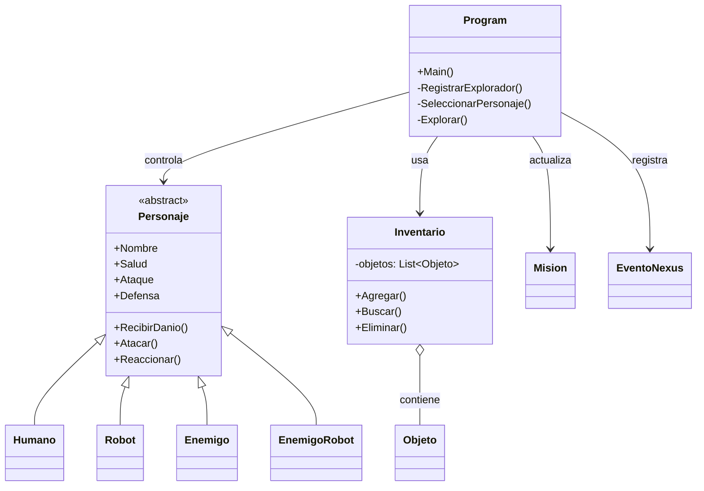
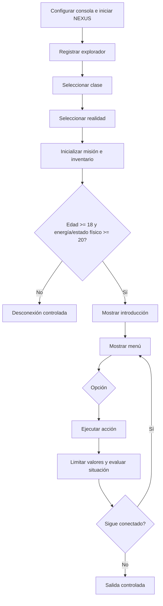

# NEXUS — Manual técnico y preparación para el examen H3

**Asignatura:** Programación II  
**Proyecto:** NEXUS System v1.0  
**Propósito:** documentar el código disponible y servir como guía de estudio sin conexión.  
**Fuente revisada:** rama `main`, archivo [Program.cs](https://github.com/estgermanwilfredocolquemi-code/nexus-v1.0/blob/main/Program.cs), proyecto [nexus 3.csproj](https://github.com/estgermanwilfredocolquemi-code/nexus-v1.0/blob/main/nexus%203.csproj) y [README.md](https://github.com/estgermanwilfredocolquemi-code/nexus-v1.0/blob/main/README.md).

> Los ejemplos identificados como **complementarios** explican conceptos solicitados por el H3 que no están implementados en el código actual. No deben confundirse con funcionalidades de NEXUS.

## 0. Guía desde cero: cómo leer `Program.cs`

Esta sección empieza por lo más básico. No necesitas saber el código de memoria: sigue el orden en que el programa se ejecuta y pregúntate qué dato cambia en cada paso. El archivo completo tiene muchas funciones, pero el juego se entiende siguiendo primero `Main()` y luego abriendo los métodos que este llama.

### 0.1 ¿Qué es `class Program` y qué es `Main()`?

En C# una **clase** es una definición que reúne datos y funciones. En NEXUS existe la clase llamada `Program`, que comienza en la línea 5 de [Program.cs](https://github.com/estgermanwilfredocolquemi-code/nexus-v1.0/blob/main/Program.cs#L5).

Dentro de esa clase está el método `Main()`, que empieza en la línea 43. **No hay una clase llamada `Main`**: `Program` es la clase y `Main` es el método de entrada. Cuando se inicia el programa, C# comienza a ejecutar las instrucciones de `Main()`.

```csharp
class Program
{
    static void Main()
    {
        Console.Title = "NEXUS SYSTEM v1.0";
        ConfigurarConsola();
        InicioNexus();
        RegistrarExplorador();
    }
}
```

Cómo leer la firma `static void Main()`:

- `static`: se puede ejecutar sin crear un objeto `Program`.
- `void`: el método no devuelve un resultado.
- `Main`: nombre especial que C# usa como entrada del programa.
- `()`: no recibe argumentos en esta versión.

Las llaves `{` y `}` delimitan el contenido de la clase y del método. Cada línea terminada en `;` suele ser una instrucción. En el programa real, `Main()` sigue con el registro, las selecciones y el menú; revisa [las líneas 43–135](https://github.com/estgermanwilfredocolquemi-code/nexus-v1.0/blob/main/Program.cs#L43-L135).

### 0.2 ¿Qué significa `using`?

Al principio del archivo aparecen instrucciones como:

```csharp
using System;
using System.Collections.Generic;
using System.Threading;
```

`using` permite usar tipos de bibliotecas de .NET con sus nombres cortos. Por ejemplo, `Console` pertenece a `System`, y `List<T>` pertenece a `System.Collections.Generic`. No son pasos del juego que se ejecutan en orden; preparan los nombres que el archivo necesita.

### 0.3 Variables: datos que el juego conserva

Una variable tiene un tipo, un nombre y, a veces, un valor inicial:

```csharp
static string nombre = "";
static int edad;
static bool conectado = true;
static string[] realidades = { "TIERRA-01", "TIERRA-02" };
```

- `string`: texto, como el nombre del jugador.
- `int`: número entero, como la edad o energía.
- `bool`: verdadero o falso; `conectado` decide si el juego sigue.
- `string[]`: arreglo de textos; `realidades` guarda opciones.
- `=`: asigna un valor. `edad = 20` guarda 20 en `edad`.
- `static`: en `Program`, estos datos pertenecen a la clase y los métodos estáticos los pueden usar sin recibirlos como parámetros.

Las variables declaradas al inicio de `Program` permanecen disponibles durante la partida. Por ejemplo, `RegistrarExplorador()` guarda el nombre y la edad allí, y otros métodos los muestran o evalúan después. Puedes verlas al inicio de [Program.cs](https://github.com/estgermanwilfredocolquemi-code/nexus-v1.0/blob/main/Program.cs#L5-L41).

### 0.4 Métodos: acciones con nombre

Un **método** es un grupo de instrucciones al que se le da un nombre. Cuando el código escribe `RegistrarExplorador();`, está llamando ese método. La definición aparece en otra parte:

```csharp
static void RegistrarExplorador()
{
    // instrucciones para pedir y guardar los datos
}
```

En la llamada se escribe el nombre seguido de paréntesis y punto y coma. En la definición se indica qué hace el método entre llaves. Separar el programa en métodos permite organizar el trabajo: `MostrarMapa()` dibuja el mapa; `LeerRango()` valida números; `Desconectar()` termina la conexión del juego.

Los métodos principales de `Program` se pueden agrupar así:

| Parte del juego | Métodos de `Program` | Qué hacen |
|---|---|---|
| Inicio y presentación | `ConfigurarConsola`, `InicioNexus`, `BarraCargaEntrada` | Configuran y muestran la pantalla inicial. |
| Datos y preparación | `RegistrarExplorador`, `SeleccionarPersonaje`, `SeleccionarRealidad`, `InicializarMision` | Piden información y crean el estado inicial. |
| Reglas de entrada | `EvaluacionInicial`, `LeerRango` | Comprueban condiciones y entradas válidas. |
| Menú y acciones | `MostrarInterfazPrincipal`, `Explorar`, `AnalizarIRIS`, `MostrarEstado`, `RecuperarEnergia`, `EscanearRealidad`, `MostrarMapa`, `ComunicacionIRIS`, `Desconectar` | Presentan el menú y ejecutan lo que el jugador elige. |
| Misión y salida | `EvaluarSituacion`, `IntentarExtraccion`, `CompletarMision`, `SalidaControlada` | Actualizan objetivos y cierran el juego cuando corresponde. |
| Ayudas visuales | `Encabezado`, `Progreso`, `Exito`, `Error`, `Pausa` | Reutilizan mensajes y formato de pantalla. |

### 0.5 El recorrido completo de `Main()`

Lee `Main()` de arriba hacia abajo. En palabras sencillas, hace esto:

1. Cambia el título de la ventana.
2. Llama a `ConfigurarConsola()` e `InicioNexus()`.
3. Llama a `RegistrarExplorador()` para solicitar nombre, género, edad y estado físico.
4. Llama a `SeleccionarPersonaje()` y `SeleccionarRealidad()`.
5. Inicializa la misión y el inventario.
6. Evalúa si edad y energía permiten comenzar.
7. Si la evaluación falla, muestra la salida y hace `return`, que significa “salir ahora de este método”.
8. Si puede continuar, entra al menú repetido.
9. Ejecuta la acción elegida y vuelve a revisar el estado.
10. Cuando `conectado` pasa a `false`, termina el ciclo y llama a `SalidaControlada()`.

### 0.6 Decisiones, ciclos y lectura del menú

**Condición `if`:** ejecuta un bloque solo cuando algo es verdadero. En `if (!conectado)`, el signo `!` significa “no”; es decir, “si no está conectado”. `return` sale del método.

**Ciclo `while`:** repite instrucciones mientras la condición sea verdadera. `while (conectado)` mantiene visible el menú hasta que alguna acción cambie `conectado` a `false`.

**Selección `switch`:** escoge qué bloque ejecutar según el valor. Como `Console.ReadLine()` lee texto, el menú compara `opcion` con `"1"`, `"2"`, etc. Cada `case` es una opción y `break` termina ese caso; no termina el ciclo `while`. `default` atiende una entrada que no coincide con ninguna opción.

**Operadores que aparecen:**

- `&&`: “y”; las dos condiciones deben ser verdaderas.
- `||`: “o”; basta con que una condición sea verdadera.
- `!`: niega una condición.
- `==`: compara si dos valores son iguales.
- `<`, `>`: comparan si un valor es menor o mayor.
- `++`: suma uno; `--`: resta uno.

### 0.7 Cómo se valida un número

`LeerRango(mensaje, minimo, maximo)` es un buen ejemplo para estudiar un método paso a paso ([líneas 3833–3862](https://github.com/estgermanwilfredocolquemi-code/nexus-v1.0/blob/main/Program.cs#L3833-L3862)):

1. Muestra el mensaje, por ejemplo “EDAD”.
2. Lee una línea del teclado.
3. `int.TryParse(..., out int numero)` intenta convertir el texto a entero sin detener el programa si no es un número.
4. Comprueba que `numero >= minimo` y `numero <= maximo`.
5. Si cumple ambas condiciones, `return numero` entrega el valor y sale del método.
6. Si no cumple, muestra error y el `while (true)` vuelve a preguntar.

Por eso, para `LeerRango("EDAD", 1, 100)`, escribir `25` devuelve 25; escribir `150` muestra error y vuelve a pedir el dato.

### 0.8 ¿Qué son `new`, una clase y un objeto?

Una clase describe cómo será un tipo de objeto. `new` crea un objeto concreto de esa clase. Por ejemplo, en `SeleccionarPersonaje()`, `new Robot(nombre, false)` construye un robot; en `InicializarMision()`, `new Inventario()` crea el inventario.

En el menú de selección, la variable `personaje` se declara del tipo general `Personaje`, pero puede guardar una instancia de `Humano`, `Robot`, `Enemigo` o `EnemigoRobot`. Es como una variable “personaje” que puede referirse a distintos tipos concretos.

### 0.9 Las clases que vienen después de `Program`

Al final del archivo se definen las clases del juego. No son nuevas aplicaciones ni nuevos puntos de entrada; son los tipos que `Program` utiliza:

- `Personaje` es la base común. Es `abstract`, por lo que se usa como molde y no se crea directamente.
- `Humano`, `Robot`, `Enemigo` y `EnemigoRobot` heredan de `Personaje`. Los dos puntos en `class Robot : Personaje` indican herencia.
- `virtual` marca un método que una clase hija puede especializar; `override` indica esa versión especializada.
- `Objeto` representa un artículo del inventario.
- `Inventario` conserva una lista de objetos y tiene métodos para agregarlos, buscarlos y eliminarlos.
- `Mision` guarda objetivos y calcula el progreso.
- `EventoNexus` guarda un tipo, una descripción y el momento en que ocurrió.
- `TipoObjeto` es un `enum`: una lista fija de categorías como `Energia`, `Escudo` y `Analizador`.

### 0.10 Respuesta corta que puedes usar en el examen

> “El punto de entrada del programa es el método estático `Main()`, que está dentro de la clase `Program`; no existe una clase llamada `Main`. `Main()` coordina el inicio, llama a métodos para registrar al explorador y configurar la misión, y después repite el menú con `while (conectado)`. El `switch` decide qué acción ejecutar. Las clases de dominio, como `Personaje`, `Inventario` y `Mision`, representan los objetos y el estado del juego.”

Practica decirlo con tus palabras y luego agrega un ejemplo de una clase derivada, como `Robot : Personaje`. No memorices solo nombres: explica qué llama a qué y qué condición hace que el juego avance o termine.

---

## 1. Propósito y funcionamiento general

NEXUS es una aplicación de consola de una misión ficticia de exploración. El jugador registra los datos de su explorador, escoge una clase y una realidad, y recorre un menú de acciones. El estado de la partida se mantiene en memoria mientras se ejecuta el programa.

El flujo principal está coordinado por `Program.Main()` (líneas 43–124 de [Program.cs](https://github.com/estgermanwilfredocolquemi-code/nexus-v1.0/blob/main/Program.cs#L43-L124)): configura la consola, inicializa la presentación, registra y configura al jugador, evalúa las condiciones de entrada y, si puede continuar, repite el menú mientras `conectado` sea verdadero. Las opciones del menú llaman métodos como `Explorar()`, `AnalizarIRIS()`, `MostrarEstado()` y `Desconectar()`.

El programa es una sola aplicación de consola y su lógica reside en un único archivo fuente. El archivo del proyecto establece `OutputType=Exe` y `TargetFramework=net10.0`: está configurado para producir un ejecutable de consola con .NET 10.

## 2. Arquitectura y responsabilidades

El diseño combina coordinación central en la clase estática `Program` con objetos de dominio:

| Tipo | Responsabilidad observada |
|---|---|
| `Program` | Mantiene el estado global de la partida, controla el flujo, muestra la interfaz y ejecuta acciones. |
| `Personaje` | Clase abstracta con datos y comportamientos compartidos de los personajes: salud, ataque, defensa, escudo, daño y reacción. |
| `Humano`, `Robot`, `Enemigo`, `EnemigoRobot` | Especializan `Personaje` con estadísticas y reacciones propias. |
| `Objeto` y `TipoObjeto` | Representan elementos del inventario y su categoría. |
| `Inventario` | Guarda una lista de objetos y permite agregar, buscar, consultar y eliminar cantidades. |
| `Mision` | Conserva objetivos, progreso, experiencia y estado de finalización de una misión. |
| `EventoNexus` | Representa un evento con tipo, descripción y fecha/hora. |

En `Program`, `inventario`, `mision` y `eventos` vinculan la lógica de la partida con instancias de esos tipos. La clase central tiene muchas responsabilidades y muchas variables estáticas: para una versión futura, se podría agrupar el estado y delegar partes del flujo en clases de servicio. Esto es una posibilidad de mejora, no una característica actual.

### Diagrama de clases simplificado



El diagrama describe las relaciones visibles en el código: herencia entre `Personaje` y sus variantes, y composición/agregación del inventario con objetos. `Program` coordina el juego y usa esas instancias.

### Estructurada y orientada a objetos

La programación estructurada organiza el procedimiento en instrucciones, decisiones, ciclos y funciones. En NEXUS, el bucle de `Main()`, el `switch` del menú, las validaciones y los métodos de interfaz muestran esa organización.

La programación orientada a objetos agrupa estado y operaciones en tipos que representan conceptos del dominio. `Inventario` reúne su lista y las operaciones sobre ella; `Personaje` reúne estadísticas y acciones comunes. NEXUS mezcla ambos estilos: existe un controlador procedimental central y, a su alrededor, objetos de dominio.

## 3. Clases, objetos y encapsulamiento

Una **clase** define un tipo; un **objeto** es una instancia creada a partir de ese tipo. Por ejemplo, `new Inventario()` crea el inventario de la partida; `new Humano(nombre)` crea un personaje humano.

- **Campo:** variable que guarda estado. Ejemplo: `private List<Objeto> objetos` en `Inventario`.
- **Propiedad:** miembro que expone o protege el acceso a un dato. Ejemplo: `Nombre { get; private set; }` en `Objeto`.
- **Método:** operación de un tipo. Ejemplo: `Agregar()`, `Buscar()` y `Eliminar()` en `Inventario`.
- **Constructor:** inicializa una instancia. El constructor de `Objeto` recibe nombre, tipo y cantidad. El constructor de `Personaje` establece sus estadísticas iniciales; los constructores derivados pasan valores a la base.
- **Modificadores:** `public` permite acceso desde otros tipos; `private` lo limita al propio tipo; `protected` permite acceso a la clase y sus derivadas.

### Encapsulamiento: ejemplo y observación

`Inventario.objetos` es privado y sus métodos ofrecen operaciones para modificar la colección. Eso concentra reglas, por ejemplo, `Agregar()` combina cantidades si ya existe un objeto con el mismo nombre, y `Eliminar()` reduce la cantidad y quita la entrada cuando llega a cero.

Hay una excepción importante: la propiedad pública `Items` devuelve la lista interna directamente. Quien recibe `Items` puede modificarla sin pasar por `Agregar()` o `Eliminar()`; por tanto, el encapsulamiento de la colección es parcial. Una mejora sería devolver una vista de solo lectura o exponer consultas específicas.

En C#, `this` se refiere a la instancia actual y puede distinguir un campo de un parámetro con el mismo nombre. **En el código actual no se usa explícitamente `this`.** Ejemplo complementario:

```csharp
class Explorador
{
    private string nombre;
    public Explorador(string nombre)
    {
        this.nombre = nombre; // campo = parámetro
    }
}
```

Los constructores actuales tienen parámetros distintos según el tipo, pero no se observó sobrecarga de constructores con varias firmas dentro de la misma clase. **Ejemplo complementario de sobrecarga:**

```csharp
class ObjetoDemo
{
    public string Nombre { get; }
    public ObjetoDemo(string nombre) => Nombre = nombre;
    public ObjetoDemo(string nombre, int cantidad) => Nombre = nombre;
}
```

## 4. Herencia, polimorfismo e interfaces

`Personaje` es abstracta: sirve como base común y no se instancia directamente. Las clases `Humano`, `Robot`, `Enemigo` y `EnemigoRobot` derivan de ella. Sus constructores llaman al constructor base mediante `: base(...)` y proporcionan tipo, salud, ataque, defensa, hostilidad y amenaza.

En `Personaje`, `AplicarEstadisticas()`, `RecibirDanio()`, `Atacar()` y `Reaccionar()` son virtuales. Las clases derivadas redefinen algunos con `override`. Esto permite especializar el comportamiento manteniendo una interfaz común.

**Polimorfismo:** cuando una variable de tipo `Personaje` contiene una instancia de `Robot`, llamar a un método virtual que `Robot` sobrescribió ejecuta la versión de `Robot`. La decisión se toma según el tipo real del objeto durante la ejecución. En `SeleccionarPersonaje()`, la variable `personaje` tiene tipo declarado `Personaje`, pero recibe instancias de clases derivadas.

**Clases y métodos abstractos:** una clase abstracta define una base que no se instancia. Un método abstracto no tiene implementación en la base y obliga a la derivada concreta a implementarlo. En el código, `Personaje` es abstracta, pero sus métodos de ejemplo son virtuales con implementación; no se observó un método abstracto.

**Interfaces:** un contrato define qué miembros debe ofrecer un tipo, sin establecer por sí mismo una jerarquía de implementación. **NEXUS no declara interfaces actualmente.** Ejemplo complementario:

```csharp
interface IAnalizable
{
    string Analizar();
}

class Analizador : IAnalizable
{
    public string Analizar() => "Resultado del análisis";
}
```

**Herencia, composición e interfaces:**
- Herencia: “es un”. Un `Robot` es un `Personaje`.
- Composición: “tiene un/contiene”. Un `Inventario` contiene objetos.
- Interfaz: “puede cumplir este contrato”. Tipos distintos podrían implementar `IAnalizable` sin heredar de una misma clase base.

## 5. Colecciones y LINQ

`List<T>` es una lista genérica: el tipo entre ángulos indica qué elementos acepta. En NEXUS, `Inventario` guarda `List<Objeto>` y `Program` guarda `List<EventoNexus>`. El código recorre listas con `foreach` y busca elementos comparando nombres.

**LINQ:** no se encontraron consultas LINQ en el código actual. El siguiente ejemplo complementario filtraría y ordenaría los objetos del inventario:

```csharp
using System.Linq;

// Ejemplo complementario; no forma parte del Program.cs actual.
var analizadores = inventario.Items
    .Where(objeto => objeto.Tipo == TipoObjeto.Analizador)
    .OrderBy(objeto => objeto.Nombre)
    .Select(objeto => objeto.Nombre)
    .ToList();
```

- `Where` filtra elementos según una condición.
- `OrderBy` ordena según una clave.
- `Select` transforma cada elemento en un resultado.
- La expresión lambda `objeto => ...` describe la operación para cada elemento.

El equivalente tradicional usa un `foreach`, un `if` y una lista de salida: suele hacer más explícitos los pasos, mientras LINQ expresa la consulta como filtro, ordenamiento y transformación. En ambos casos conviene revisar qué tipo de elemento sale de cada paso y si la consulta se ejecuta inmediatamente o de forma diferida.

## 6. Análisis del funcionamiento

### Flujograma: inicio de una partida



Este flujo corresponde a las llamadas de `Main()`, `InicializarMision()` y `EvaluacionInicial()`. La condición inicial rechaza edad menor de 18 o energía/estado físico menor de 20; después de cada acción, el programa limita valores y vuelve a evaluar la situación.

### Seguimiento de un objeto

En `InicializarMision()` se añaden una Célula de Energía y un Analizador, ambos con cantidad 1. Supongamos que se obtiene otro Analizador y se llama a `inventario.Agregar(new Objeto("Analizador", TipoObjeto.Analizador, 1))`:

| Momento | Entrada/operación | Analizador en la lista |
|---|---|---:|
| Inicialización | Agregar Analizador, cantidad 1 | 1 |
| Hallazgo | Agregar otro Analizador, cantidad 1 | 2 |
| Uso | `Eliminar("Analizador")` | 1 |
| Segundo uso | `Eliminar("Analizador")` | Se elimina de la lista |

La combinación y eliminación descritas se implementan en `Inventario.Agregar()` y `Inventario.Eliminar()`. El ejemplo de hallazgo es una llamada hipotética para mostrar el comportamiento del método.

### Predicción de código

Con el estado anterior, `Buscar("analizador")` encuentra el objeto aunque el uso de mayúsculas sea distinto, porque la comparación usa `StringComparison.OrdinalIgnoreCase`. Si su cantidad es 2, una llamada a `Eliminar("Analizador")` deja cantidad 1 y devuelve `true`. Si se elimina de nuevo, retira el objeto y también devuelve `true`. Una llamada posterior devuelve `false`, pues ya no lo encuentra.

### Modificación razonada

Si se cambia `Items` para devolver una colección de solo lectura, código consumidor ya no podrá añadir objetos directamente a la lista. Esto fortalece el encapsulamiento, pero el código que dependiera de mutar `Items` deberá usar métodos explícitos del inventario. Antes del cambio se deben buscar todos los usos de `Items` y actualizar los que modifiquen la colección.

## 7. Preparación para el examen: seis preguntas razonadas

### 1. POO y arquitectura
**Pregunta:** ¿Por qué NEXUS no es puramente orientado a objetos aunque tenga clases de dominio?  
**Respuesta razonada:** porque `Program` concentra el flujo principal y conserva muchas variables estáticas globales, coordinando directamente entrada, interfaz y estado. Clases como `Inventario` sí agrupan datos y operaciones. El diseño combina procedimientos estructurados con modelado mediante objetos.

### 2. Clases, instanciación y encapsulamiento
**Pregunta:** ¿Qué sucede al ejecutar `new Objeto("Analizador", TipoObjeto.Analizador, 1)` y qué parte del estado se protege?  
**Respuesta razonada:** se crea un objeto y su constructor establece nombre, tipo y cantidad. Sus propiedades permiten consultar valores; setters privados impiden que otros tipos los reemplacen libremente. En cambio, `Inventario.Items` devuelve una lista modificable directamente, por lo que el encapsulamiento del inventario no es completo.

### 3. Herencia y polimorfismo
**Pregunta:** Si `personaje` es de tipo `Personaje`, pero contiene un `Robot`, ¿qué `Reaccionar()` se ejecuta?  
**Respuesta razonada:** se ejecuta `Robot.Reaccionar()` porque el método es virtual y `Robot` lo redefine con `override`; el tipo real del objeto determina la implementación durante la ejecución.

### 4. Interfaces y diseño
**Pregunta:** ¿Cómo permitirías que objetos de clases diferentes se puedan analizar sin hacer que todos hereden de `Personaje`?  
**Respuesta razonada:** definiría una interfaz como `IAnalizable` con `Analizar()` y haría que cada tipo compatible la implemente. La interfaz declara el contrato; cada clase aporta su implementación. Es un ejemplo complementario porque NEXUS no tiene interfaces.

### 5. Listas y LINQ
**Pregunta:** ¿Qué diferencia hay entre `Where(...).Select(...)` y un `foreach` con un `if`?  
**Respuesta razonada:** ambos pueden filtrar y transformar datos. LINQ expresa operaciones encadenadas; el recorrido tradicional muestra cada paso de forma explícita. Para NEXUS, LINQ sería una adición, no una descripción del código actual.

### 6. Predicción y modificación
**Pregunta:** Si `Eliminar("Analizador")` encuentra cantidad 1, ¿qué devuelve y cómo queda la lista? ¿Qué cambia si la cantidad era 2?  
**Respuesta razonada:** con 1, reduce a 0, quita el elemento y devuelve `true`; con 2, deja cantidad 1 y devuelve `true`. Si no hay coincidencia devuelve `false`. La búsqueda no distingue mayúsculas y minúsculas.

## 8. Diagnóstico de aprendizaje: prompt espejo

Este diagnóstico se basa exclusivamente en los mensajes escritos por el usuario en esta conversación. No atribuye al usuario explicaciones, respuestas ni ejemplos producidos por el asistente.

### Evidencia disponible

El usuario pidió analizar el repositorio con relación a una consigna de estudio, solicitó la explicación en español, preguntó qué requisitos estaban cumplidos y pidió completar lo faltante. Después siguió los pasos para cambiar la visibilidad del repositorio y compartió capturas del estado en GitHub. También preguntó cómo ejecutar el prompt espejo y aclaró que ese era el resultado que quería. En esta conversación no respondió preguntas técnicas ni explicó por sí mismo fragmentos de código.

### 1. Fortalezas demostradas

- **Atención al objetivo:** aportó la consigna completa y pidió revisar el proyecto contra sus requisitos.
- **Seguimiento del trabajo:** preguntó por las brechas y pidió ayuda para completarlas.
- **Verificación práctica:** siguió el cambio de visibilidad en GitHub y compartió una captura de la página que indicaba que el repositorio era público.
- **Aclaración de necesidades:** pidió que la explicación fuera en español y precisó que quería el prompt espejo.

Estas son fortalezas observables de organización y seguimiento. No demuestran por sí solas dominio de los conceptos técnicos del Hito 3.

### 2. Falencias observadas

No hay errores conceptuales del usuario observables en la conversación. Tampoco hay explicaciones propias suficientes para detectar dificultades de razonamiento, dudas recurrentes o conceptos mal comprendidos. La falta de evidencia no debe interpretarse como una falencia.

### 3. Diagnóstico del Hito 3

| Concepto | Clasificación | Justificación |
|---|---|---|
| POO | Evidencia insuficiente | El usuario pidió analizar el proyecto, pero no explicó con sus palabras el paradigma ni sus principios. |
| Clases y objetos | Evidencia insuficiente | No describió clases, instancias o relaciones del código por cuenta propia. |
| Constructores | Evidencia insuficiente | No explicó inicialización, parámetros ni sobrecarga. |
| Encapsulamiento | Evidencia insuficiente | No analizó modificadores de acceso ni protección del estado. |
| Herencia | Evidencia insuficiente | No explicó clases base y derivadas con un ejemplo propio. |
| Polimorfismo | Evidencia insuficiente | No predijo qué implementación se ejecuta en una llamada virtual. |
| Interfaces | Evidencia insuficiente | No explicó contratos ni implementación de interfaces. |
| Listas genéricas | Evidencia insuficiente | No analizó por cuenta propia una colección `List<T>`. |
| LINQ | Evidencia insuficiente | No escribió ni interpretó consultas LINQ. |

### 4. Forma de aprender

La evidencia muestra que el usuario busca relacionar el proyecto con los requisitos de la asignatura, pide explicaciones en el idioma que necesita y verifica en GitHub los cambios prácticos. También identifica cuando la conversación se desvía y vuelve a precisar su objetivo. No hay evidencia suficiente para valorar cómo analiza código por sí mismo, contrasta explicaciones técnicas o corrige errores de programación.

### 5. Plan de estudio prioritario

1. **POO, clases, objetos y encapsulamiento.** Ejercicio: explica qué representa cada clase principal de NEXUS; señala un campo, una propiedad y un método; analiza qué puede modificarse mediante `Inventario.Items` y qué cambiaría al ofrecer una colección de solo lectura.
2. **Constructores, `this` y `base`.** Ejercicio: sigue paso a paso la creación de un `Robot` desde la selección del personaje hasta el constructor de `Personaje`; escribe una sobrecarga complementaria y explica qué inicializa cada constructor.
3. **Herencia y polimorfismo.** Ejercicio: usa una variable `Personaje` que contenga un `Robot`; predice qué versión de `Reaccionar()` se ejecuta y justifica la respuesta con `virtual` y `override`.
4. **Interfaces y diseño.** Ejercicio: diseña una interfaz `IAnalizable` para dos clases no relacionadas por herencia; identifica el contrato y compara la solución con herencia y composición.
5. **Listas genéricas y LINQ.** Ejercicio: filtra objetos del inventario por tipo, ordénalos por nombre y proyecta sus nombres con `Where`, `OrderBy` y `Select`; resuelve el mismo caso con `foreach` y compara resultados.

### 6. Conclusión

La conversación demuestra organización para seguir una consigna, verificación práctica en GitHub y capacidad para pedir una explicación en el idioma requerido. No demuestra todavía comprensión técnica de los temas del Hito 3 porque el usuario no respondió ejercicios ni explicó el código. Antes del examen debería poder describir la arquitectura de NEXUS, explicar la creación y el estado de sus objetos, predecir llamadas polimórficas y resolver ejercicios de interfaces, listas y LINQ sin ayuda.

## 9. Cómo ejecutar el proyecto

Requiere el SDK de .NET 10, porque el archivo de proyecto apunta a `net10.0`. Desde la carpeta del proyecto:

```bash
dotnet run --project "nexus 3.csproj"
```

El README del repositorio debe mantenerse actualizado si cambia el nombre del proyecto, la versión objetivo o el modo de ejecución.

## 10. Lista de comprobación antes de entregar

- [ ] Confirmar que el repositorio es público y que el enlace abre.
- [ ] Revisar que solo se publiquen archivos necesarios; no incluir credenciales ni datos personales.
- [ ] Mantener `.vs/`, `bin/` y `obj/` fuera de Git.
- [ ] Actualizar este manual si cambia el código.
- [ ] Exportar este Markdown a PDF para consulta sin Internet, si el docente lo solicita o la plataforma lo permite.
- [ ] Entregar el enlace del repositorio y el manual en Moodle según las instrucciones del curso.
