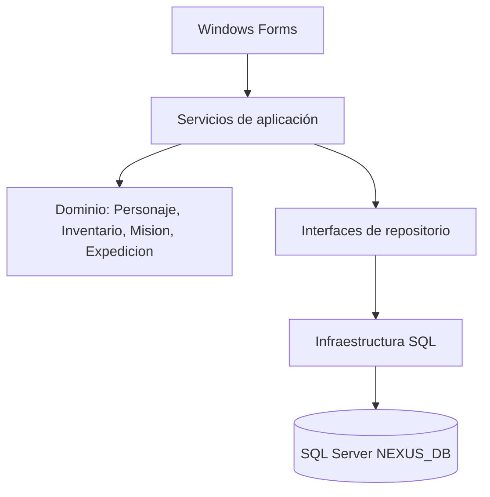

# NEXUS Hito 4 — Integración propuesta

## Estado observado del repositorio

El proyecto actual compila como aplicación de consola `net10.0` en `nexus 3.csproj`. La lógica y la interacción están concentradas principalmente en `Program.cs`. En la versión inspeccionada todavía no hay formularios Windows Forms, repositorios SQL ni guardado/carga real.

## Arquitectura objetivo

- **Presentación:** formularios para menú, perfiles, selección/continuación de partidas, mapa e inventario.
- **Aplicación:** casos de uso `CrearPartida`, `GuardarPartida`, `CargarPartida`, `ListarPartidas` y `EliminarPartida`.
- **Dominio:** conserva reglas de personajes, inventario, misiones, realidades y eventos.
- **Infraestructura:** `Microsoft.Data.SqlClient`, repositorios, parámetros SQL y transacciones.

## Mapeo desde las clases actuales

| Código actual | Persistencia |
|---|---|
| `Personaje`, `Humano`, `Robot` | `Expedition.CharacterName`, `Archetype`, `Health`, `Shield` |
| variables de energía/conexión/peligro | columnas de `Expedition` |
| `realidad` | FK `Expedition.RealityId` |
| `Inventario` y `Objeto` | `InventoryItem` + `ItemDefinition` |
| `Mision` | `ExpeditionMission` + `MissionDefinition` |
| hitos de misión | `MissionObjective` + `ObjectiveProgress` |
| `EventoNexus` | `GameEvent` |
| posición del jugador | `PositionRow`, `PositionColumn` |

## Flujo de guardado y recuperación

1. La interfaz solicita guardar.
2. El servicio valida el estado del dominio.
3. El repositorio abre una conexión SQL Server.
4. Una transacción actualiza la expedición, inventario, progreso y eventos.
5. Se confirma la transacción; ante error se revierte.
6. Al continuar, el servicio consulta la partida y reconstruye los objetos C#.

Usar siempre `SqlParameter`/parámetros tipados; nunca concatenar entradas del jugador en SQL. Mantener la cadena de conexión fuera del repositorio y del control de versiones.

## Secuencia inicial de implementación

1. Ejecutar `database/01_create_nexus_db.sql` en SQL Server Management Studio.
2. Verificar las 10 tablas, las FK y los cuatro registros de realidad.
3. Crear proyectos/capas sin borrar el prototipo actual.
4. Añadir `Microsoft.Data.SqlClient` al proyecto de infraestructura.
5. Implementar primero perfil + crear partida + guardar/cargar estado básico.
6. Migrar inventario, misión y eventos.
7. Incorporar Windows Forms y conectar formularios a servicios.
8. Ejecutar la prueba de supervivencia y guardar evidencias.

## Configuración segura

Usar una cadena de conexión local mediante configuración de desarrollo o variable de entorno. No subir contraseñas, tokens ni archivos locales de configuración. Documentar un ejemplo sin credenciales reales.