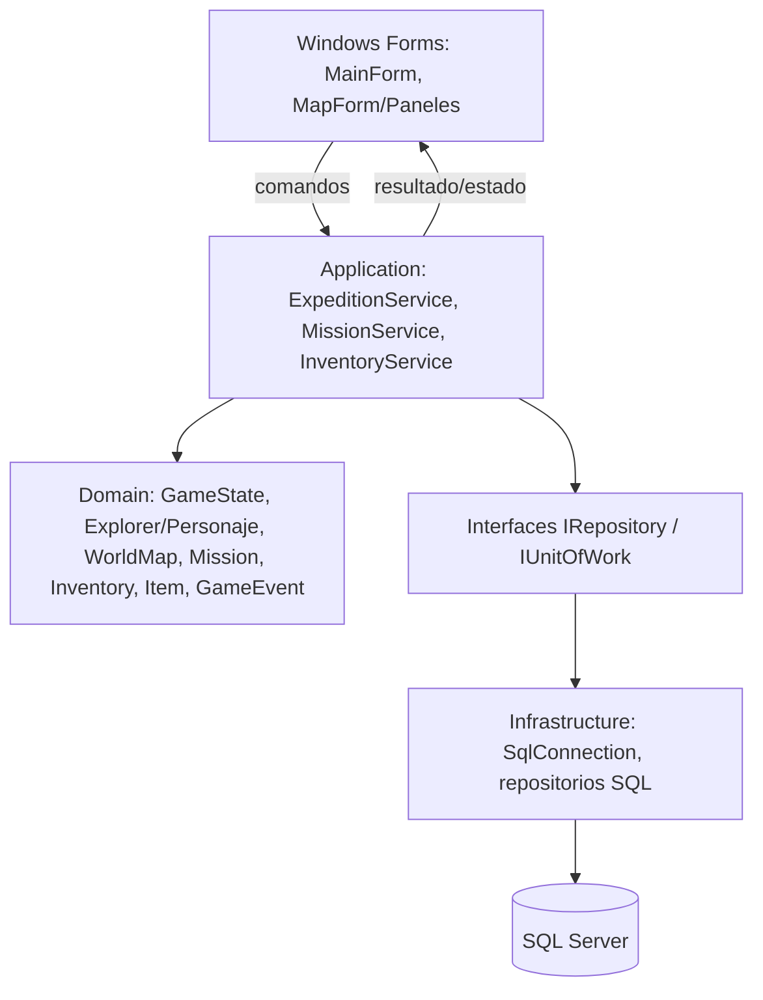

# Arquitectura propuesta

## Principio

Conservar la lógica y el vocabulario de H3, pero sacar reglas del gran `Program` y de la consola. WinForms presenta estados y envía intenciones; servicios ejecutan reglas; repositorios guardan/cargan; SQL Server no se consulta desde controles. El programa actual puede seguir siendo un prototipo hasta que la migración funcional esté lista.

## Diagrama

Flujo: el formulario envía `MoveTo`, `UseItem`, `Scan`, `Extract`; el servicio valida y aplica la regla al modelo de dominio; devuelve resultado y estado actualizado; la UI refresca controles. Al guardar, el servicio usa repositorios y una transacción. Errores técnicos se traducen a mensajes accionables, sin exponer detalles de conexión al jugador.

## Componentes

- **Presentación (`Nexus.WinForms`):** formularios principal, menú, exploración/mapa, misión, exploradores e inventario. Controles solo muestran estado y validan formato; no calculan daño o progreso. Usar `async` en operaciones SQL y evitar `Thread.Sleep` en UI.
- **Aplicación (`Nexus.Application`):** casos de uso para iniciar/continuar expedición, mover, escanear, recuperar energía, resolver encuentro, usar objeto, extraer y guardar. Coordina dominio y persistencia, sin depender de WinForms.
- **Dominio (`Nexus.Domain`):** `Personaje`, `Humano`, `Robot`, enemigos, `Inventario`, `Objeto`, `Mision`, `EventoNexus`, `Realidad/Mapa` y `Expedicion`. Validaciones de energía, daño, objetivos y transición de estados. Retirar `Console.WriteLine` de las reglas y devolver resultados/eventos.
- **Infraestructura (`Nexus.Infrastructure`):** repositorios SQL Server con parámetros, mapeo, transacciones y configuración externa de conexión. Migraciones/scripts SQL versionados.
- **Composición:** proyecto de inicio construye dependencias; SQL desconectado debe impedir guardar/cargar con mensaje y ofrecer reintento. No se almacenan contraseñas en el repositorio.

## Migración incremental

1. Fijar reglas existentes mediante casos de uso y separar resultados de consola.
2. Crear `GameState` que agrupe campos estáticos y definir contratos entre acciones.
3. Implementar persistencia relacional y guardar/cargar un estado sencillo.
4. Crear formularios conectados a servicios; comenzar por menú y mapa 2D de matrices.
5. Migrar una acción cada vez (escaneo, inventario, combate, extracción) y mantener coherencia con H3.

La solución actual usa `net10.0`; antes de activar WinForms se debe confirmar soporte del SDK/IDE destino y cambiar a un TFM Windows, `UseWindowsForms=true` y `OutputType=WinExe`. No cambiar el proyecto existente durante esta fase documental.
