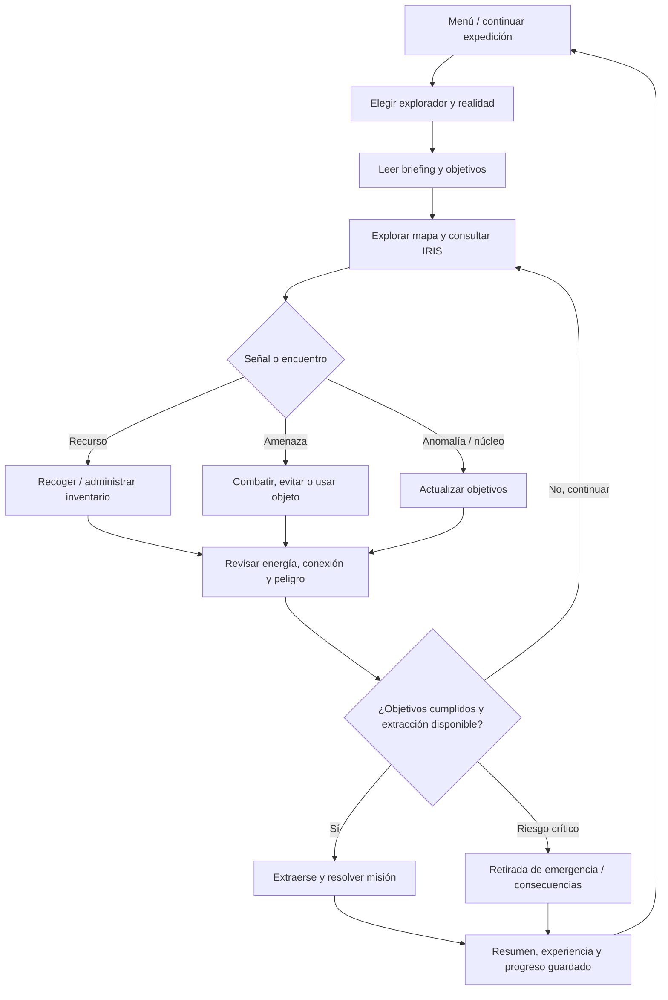

# NEXUS: diseño de la experiencia de juego

## Visión

NEXUS es una aventura narrativa de exploración táctica del multiverso. El jugador es un explorador de una organización que investiga anomalías en realidades inestables. En cada salida elige su perfil, consulta señales de IRIS, administra energía y recursos, decide cómo acercarse a amenazas y busca completar objetivos antes de extraerse. La motivación es descubrir qué ocurrió con el núcleo de la anomalía, sobrevivir a realidades distintas, conseguir equipo y desbloquear nuevas expediciones.

La propuesta conserva los elementos reales de H3: registro del explorador, selección Humano/Robot, cuatro realidades (TIERRA-01, TIERRA-02, TIERRA-07 y NEXUS-09), mapas de caracteres, energía, conexión, peligro, IRIS, objetos, encuentros y la misión “LA ANOMALÍA PERDIDA”. La futura interfaz gráfica representa la misma aventura; no cambia el género ni descarta sus reglas.

## Ciclo principal



En la entrega de H3, “continuar” significa volver al menú de consola y elegir una acción; la propuesta gráfica hace persistente el mapa de la expedición mientras el jugador alterna paneles. La barra de energía y la conexión comunican el coste/riesgo; el peligro no es energía y se presenta como indicador separado.

## Mecánicas y reglas

- **Exploradores:** `Personaje` define salud, ataque, defensa, escudo, amenaza y comportamiento. `Humano` empieza con escudo 70; `Robot` amistoso dispone de escudo 100. La futura selección muestra diferencias antes de confirmar. `Enemigo` y `EnemigoRobot` son actores de encuentros, no opciones de personaje jugador por defecto.
- **Mapas y movimiento:** H3 construye matrices `char[,]` por realidad y dibuja zonas y símbolos: explorador, recursos, anomalías, entidades y extracción. La GUI mantiene el mapa por celdas, resalta posición y destinos y ofrece inspección al seleccionar una celda. El coste de movimiento debe reutilizar la regla existente o definirse y probarse antes de presentarlo como regla nueva.
- **Energía, conexión y peligro:** estado global inicializa conexión a 100; energía y peligro se configuran durante el inicio/partida. Recuperar energía consume una célula si está disponible; si no, la recuperación depende de conexión y peligro (25 segura, 15 limitada, 10 emergencia, con variación de conexión/peligro según el código). Los valores se limitan y la situación puede provocar desconexión/extracción. La interfaz confirma cualquier cambio.
- **Misiones:** `Mision` “LA ANOMALÍA PERDIDA” reúne cuatro hitos booleanos: anomalía, núcleo, entidad superada y extracción. `Progreso` cuenta hitos (0–4); completar y extraerse produce cierre, experiencia y resumen. En la propuesta los objetivos son una lista visual con estado pendiente/en curso/completado, sin inventar misiones adicionales para la primera versión.
- **Inventario:** `Inventario` agrupa objetos del mismo nombre y cantidad; incluye tipos de energía, escudo, ataque, analizador, núcleo y módulo desconocido. Seleccionar un objeto muestra efecto y cantidad; el jugador confirma uso. La célula de energía sube hasta 25 y se consume. Los cambios de misión y botín se conservan entre sesiones en la evolución SQL.
- **IRIS y eventos:** analizar, escanear y consultar comunicaciones/narrativa se presentan como paneles laterales o ventanas contextuales, con resultados vinculados al mapa. `EventoNexus` registra tipo, descripción y momento durante la sesión.

## Pantallas y navegación

Los bocetos son esquemáticos, priorizan jerarquía y flujo. Los comandos son clicables en la futura aplicación; Escape vuelve al panel anterior, y la confirmación aparece antes de abandonar una expedición.

### 1. Menú principal

```text
┌──────────────────────────── NEXUS ────────────────────────────┐
│       CENTRO DE OPERACIONES / IRIS                              │
│                                                                  │
│   [ CONTINUAR EXPEDICIÓN ]     Última realidad: TIERRA-01        │
│   [ NUEVA EXPEDICIÓN ]         Explorador: Cadete                │
│   [ EXPLORADORES / EQUIPO ]    Misión: La anomalía perdida       │
│   [ REGISTRO DE MISIONES ]                                      │
│   [ SALIR ]                                                      │
│                                              Conexión: 100%       │
└──────────────────────────────────────────────────────────────────┘
```

Navega a selección/continuación, expediciones y equipo. Si no hay guardado, “Continuar” se desactiva con una explicación. Salir solicita confirmación si hay progreso sin guardar.

### 2. Exploración / mapa

```text
┌────────────── TIERRA-01 ───────────────┬──── IRIS ─────────────┐
│ Energía 72  Conexión 84  Peligro 31    │ Objetivos             │
│                                        │ □ Hallar anomalía     │
│   · · R · · ·                          │ □ Recuperar núcleo    │
│   · X · Z · ·       Leyenda             │ □ Superar entidad     │
│   · · @ · C ·       @ jugador           │                      │
│   Y · · · · ·       R recurso           │ IRIS: movimiento X    │
│                                        │ detectado al norte    │
├────────────────────────────────────────┴──────────────────────┤
│ [Mover] [Escanear] [Inventario] [Misión] [Extraer] [Menú]     │
└────────────────────────────────────────────────────────────────┘
```

La celda seleccionada muestra nombre, riesgo y acción. La leyenda siempre está visible; colores acompañan símbolos y etiquetas. IRIS se puede plegar sin ocultar indicadores críticos.

### 3. Misiones

```text
┌──────────────────── REGISTRO DE MISIÓN ───────────────────────┐
│ LA ANOMALÍA PERDIDA        TIERRA-01          Progreso 2/4     │
│                                                                  │
│ ✓ Localizar anomalía       Confirmada por IRIS                   │
│ ✓ Recuperar núcleo         1 núcleo recuperado                   │
│ ○ Superar entidad          Amenaza hostil pendiente              │
│ ○ Extraerse                Disponible al completar objetivos     │
│                                                                  │
│ Recompensa prevista: experiencia y recursos recuperados           │
│ [Volver al mapa]                         [Abandonar expedición]   │
└──────────────────────────────────────────────────────────────────┘
```

La acción de abandonar explica consecuencias y exige confirmación. El progreso reproduce los cuatro indicadores de `Mision`.

### 4. Exploradores / inventario

```text
┌────────────── EXPLORADOR ─────────────┬──── INVENTARIO ────────┐
│ Cadete (Humano)                       │ Célula de energía   x2 │
│ Salud 100   Escudo 70                 │ Analizador IRIS     x1 │
│ Ataque 20   Defensa 10                │ Núcleo recuperado  x1 │
│                                       │                         │
│ Robot: escudo 100, defensa 18         │ [Usar] [Detalles]      │
│                                       │                         │
│ [Seleccionar perfil]                 │ [Volver]               │
└───────────────────────────────────────┴─────────────────────────┘
```

El panel compara perfiles antes de iniciar. Cantidad, efecto y requisitos preceden a “Usar”; objetos clave de misión se distinguen de consumibles y no se eliminan accidentalmente.

## Experiencia de usuario

- Legibilidad: texto principal equivalente a 12–14 pt o superior, contraste alto, escalado DPI y opción de no depender solo del color.
- Jerarquía: ubicación y objetivo en primer plano; salud/energía/conexión/peligro persistentes; datos narrativos secundarios y plegables.
- Consistencia: misma ubicación para volver, confirmación, estados y botones; verbos concretos y nombres estables para acciones.
- Navegación: máximo dos pasos desde mapa a inventario/misión; volver conserva mapa y selección. Atajos de teclado complementan botones, nunca son la única vía.
- Retroalimentación: indicar resultado inmediatamente, delta numérico de recursos, progreso del objetivo y mensajes accesibles; errores dicen cómo recuperarse. Las acciones destructivas requieren confirmación.

## Alcance y restricciones

**Prioridad (primera evolución):** formularios de menú, selección de explorador/realidad, mapa navegable a partir de las matrices existentes, panel IRIS, misión, inventario, indicadores y guardado/carga SQL de expedición. Extraer lógica de `Program.cs` a clases comprobables sin alterar reglas sin documentarlo.

**Opcional posterior:** animaciones, audio, editor de mapas, más campañas, árbol de habilidades, estadísticas extensas y juego en red. No son necesarias para demostrar el ciclo central.

**Restricciones:** escritorio Windows, C# y Windows Forms; SQL Server para persistencia; conservar narrativa, realidades, clases y reglas de H3; no presentar persistencia como ya implementada; separar UI, dominio y datos; consultas parametrizadas y transacciones; permitir juego solo en el entorno configurado, con error claro de conexión. WinForms no es un motor 3D: la propuesta es un juego gráfico 2D de tablero/celdas y paneles. La entrega documenta diseño y camino técnico, no promete una aplicación WinForms ya construida.
