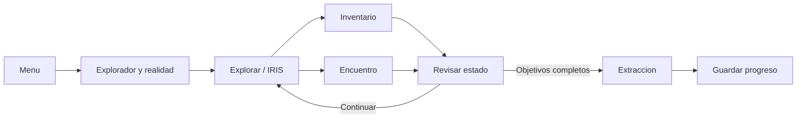
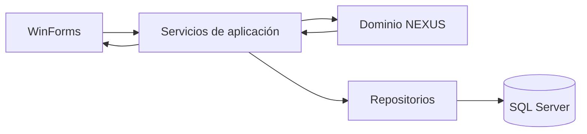

# Diagramas de NEXUS

Estos diagramas acompañan la propuesta documental y no representan pantallas ya implementadas.

## Ciclo de partida

## Arquitectura

Ver las definiciones y descripciones completas en [diseño del juego](../diseno-del-juego.md) y [arquitectura propuesta](../arquitectura-propuesta.md).
