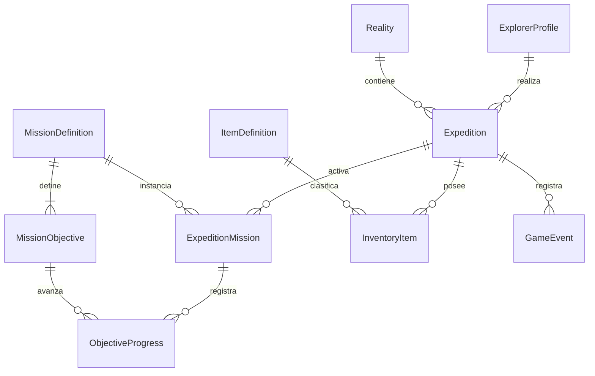

# Modelo de datos propuesto para SQL Server

El modelo persiste una campaña/expedición recuperable. La fuente de entidades son `Personaje`, `Inventario`, `Objeto`, `Mision` y `EventoNexus` de `Program.cs`; las tablas de cuenta, catálogo, realidad y expedición son extensiones explícitas necesarias para persistencia y varias misiones. No se afirma que existan en H3.

## Entidades

| Tabla | Campos clave | Propósito |
|---|---|---|
| `ExplorerProfile` | `ExplorerId` PK, `Name`, `Archetype`, `CreatedAt` | Perfil persistente; `Archetype` discrimina Humano/Robot |
| `Reality` | `RealityId` PK, `Code` UNIQUE, `Name`, `MapDefinition` | TIERRA-01/02/07 y NEXUS-09; mapa versionado como JSON o filas de celdas |
| `Expedition` | `ExpeditionId` PK, `ExplorerId` FK, `RealityId` FK, `Status`, `Energy`, `Connection`, `Danger`, `Health`, `Shield`, `PositionRow`, `PositionColumn`, `StartedAt`, `UpdatedAt`, `RowVersion` | Estado reanudable; `RowVersion` controla escrituras concurrentes |
| `MissionDefinition` | `MissionId` PK, `Code` UNIQUE, `Name`, `Description` | Catálogo, inicialmente LA ANOMALÍA PERDIDA |
| `MissionObjective` | `ObjectiveId` PK, `MissionId` FK, `Code`, `SortOrder`, `Description` | Objetivos configurables: anomalía, núcleo, entidad, extracción |
| `ExpeditionMission` | `ExpeditionMissionId` PK, `ExpeditionId` FK, `MissionId` FK, `Status`, `Experience` | Instancia de misión en una expedición |
| `ObjectiveProgress` | `ExpeditionMissionId` FK, `ObjectiveId` FK, `CompletedAt`, `ProgressValue`; PK compuesta | Avance por objetivo, reemplaza cuatro booleanos al crecer |
| `ItemDefinition` | `ItemId` PK, `Code` UNIQUE, `Name`, `Type`, `Stackable`, `EffectData` | Catálogo derivado de `TipoObjeto`/`Objeto` |
| `InventoryItem` | `ExpeditionId` FK, `ItemId` FK, `Quantity`, PK compuesta | Cantidades por expedición |
| `GameEvent` | `EventId` PK, `ExpeditionId` FK, `Type`, `Description`, `OccurredAt` | Historial de `EventoNexus` |

Perfil guarda identidad estable; los valores temporales de combate corresponden a la expedición. En una versión posterior se puede guardar progreso permanente del explorador por separado si el diseño de metajuego lo requiere.

## Relaciones

## Guardado y recuperación

Al iniciar/cargar, consultar expedición por identificador (o la más reciente `Status='Active'`) y cargar perfil, realidad, misión/objetivos, inventario y posición. Validar que el mapa guardado corresponda a una versión compatible; reconstruir el modelo y presentar último estado. Guardar cambios de una acción y su evento en una transacción: actualizar `Expedition`, progreso, inventario y eventos juntos. Extracción marca estado y objetivos atómicamente. Usar `rowversion` para detectar dos sesiones que intentan sobrescribir el mismo estado.

Usar SQL Server con restricciones FK, `NOT NULL`, `CHECK` de cantidades/rangos y claves únicas de código. Consultas parametrizadas; cadena de conexión en configuración local/secretos de entorno, nunca en Git. Índices: `Expedition(ExplorerId, Status, UpdatedAt)`, `GameEvent(ExpeditionId, OccurredAt)`. Evitar guardar credenciales o texto arbitrario de usuario en consultas. Para prototipo un mapa JSON versionado dentro de `Reality` simplifica importación; para edición/búsquedas por celda usar tabla `MapCell(RealityId, MapVersion, Row, Column, Symbol)` con PK compuesta.

## Decisiones pendientes de implementación

Definir política de múltiples partidas por explorador, si existe guardado automático por acción o en puntos seguros, borrado/retención y si el mapa es catálogo fijo. El alcance inicial recomendado: una expedición activa por explorador y guardado automático al resolver cada acción, tras comprobar transacción y recuperación.
