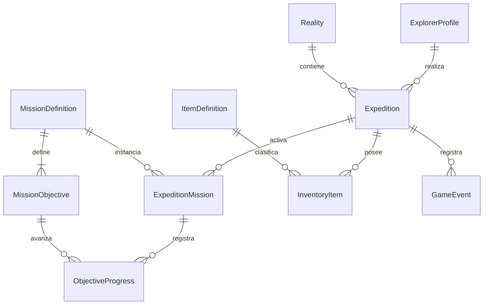

# Modelo de datos para SQL Server (implementado en Windows Forms)

El modelo persiste una campaña/expedición recuperable. El esquema ejecutable se encuentra en `WindowsForms/database/002-schema.sql`; su acceso desde C# está en `WindowsForms/NexusPersistence.cs`. La fuente de entidades son `Personaje`, `Inventario`, `Objeto`, `Mision` y `EventoNexus` de `Program.cs`; las tablas de cuenta, catálogo, realidad y expedición son extensiones necesarias para persistencia.

## Entidades

| Tabla | Campos clave | Propósito |
|---|---|---|
| `ExplorerProfile` | `ExplorerId` PK, `Name` UNIQUE, `Gender`, `Age`, `Fitness`, `CharacterId`, `CreatedAt` | Perfil persistente y personaje seleccionado |
| `Reality` | `RealityId` PK, `Code` UNIQUE, `Name` | Catálogo: TIERRA-01/02/07 y NEXUS-09 |
| `Expedition` | `ExpeditionId` PK, `ExplorerId` FK, `RealityId` FK, `MissionId` FK, `SaveName`, `Status`, `Energy`, `ConnectionValue`, `Danger`, `PositionRow`, `PositionColumn`, `SnapshotJson`, `StartedAt`, `UpdatedAt`, `RowVersion` | Estado reanudable; la instantánea conserva atributos de personaje, misión, inventario, eventos y mapa |
| `MissionDefinition` | `MissionId` PK, `Name` UNIQUE, `Description` | Catálogo, inicialmente LA ANOMALÍA PERDIDA |
| `MissionObjective` | `ObjectiveId` PK, `MissionId` FK, `ObjectiveOrder`, `Description` | Cuatro objetivos de anomalía, núcleo, entidad y extracción |
| `ExpeditionMission` | `ExpeditionMissionId` PK, `ExpeditionId` FK, `MissionId` FK, `Status`, `Experience` | Instancia de misión en una expedición |
| `ObjectiveProgress` | `ExpeditionMissionId` FK, `ObjectiveId` FK, `Completed`, `CompletedAt`; PK compuesta | Avance por objetivo |
| `ItemDefinition` | `ItemId` PK, `Name`, `TypeName` UNIQUE compuesta | Catálogo derivado de `TipoObjeto`/`Objeto` |
| `InventoryItem` | `ExpeditionId` FK, `ItemId` FK, `Quantity`, PK compuesta | Cantidades por expedición |
| `GameEvent` | `EventId` PK, `ExpeditionId` FK, `Type`, `Description`, `OccurredAt` | Historial de `EventoNexus` |

Perfil guarda identidad estable; los valores temporales de combate corresponden a la expedición. En una versión posterior se puede guardar progreso permanente del explorador por separado si el diseño de metajuego lo requiere.

## Relaciones

## Guardado y recuperación

Al continuar, consultar la expedición por identificador y rehidratar su `SnapshotJson`. Guardar manualmente actualiza `Expedition`, el inventario relacional, progreso de objetivos y eventos en una transacción. El campo `rowversion` permite añadir control optimista de concurrencia en una iteración posterior.

Usar SQL Server con claves foráneas, restricciones `CHECK`, nombres únicos de ranura por perfil e índices de consulta. Los comandos C# están parametrizados; la cadena de conexión se obtiene de `NEXUS_SQL_CONNECTION_STRING` o del valor predeterminado local, nunca contiene una contraseña en el repositorio. El mapa se serializa como filas en `SnapshotJson` para recuperar el mismo terreno.

## Estado de implementación

Windows Forms ofrece guardado manual por ranura con nombre, consulta/listado, recuperación y borrado. Cada guardado actualiza el estado principal, inventario, progreso de objetivos y eventos dentro de una transacción. El mapa del explorador y la instantánea rehidratable se guardan junto al modelo relacional. La consola original sigue siendo ejecutable y no requiere SQL.
