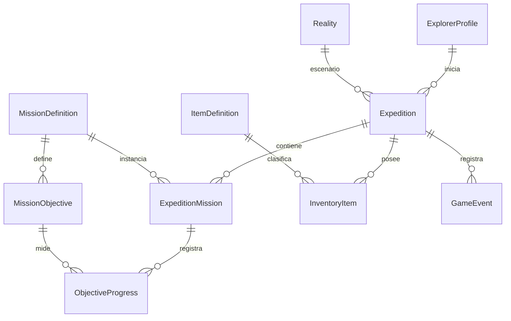

# NEXUS Hito 4 — Modelo relacional inicial

## Alcance

El modelo conserva datos que ya existen en el videojuego: perfil del explorador, clase de personaje, realidad seleccionada, energía, conexión, peligro, salud, escudo, investigaciones IRIS, recursos, posición, misión, objetivos, inventario y eventos.

## Tablas

1. `ExplorerProfile`: identidad estable del jugador.
2. `Reality`: catálogo de las cuatro realidades actuales.
3. `Expedition`: una partida y el estado recuperable del personaje.
4. `MissionDefinition`: catálogo de misiones, incluida LA ANOMALÍA PERDIDA.
5. `MissionObjective`: objetivos definidos para una misión.
6. `ExpeditionMission`: misión activada en una partida.
7. `ObjectiveProgress`: avance de cada objetivo.
8. `ItemDefinition`: catálogo de objetos.
9. `InventoryItem`: objetos y cantidades por partida.
10. `GameEvent`: historial cronológico de sucesos.

## Relaciones

## Atributos persistentes del videojuego

`CharacterName`, `Archetype`, `RealityId`, `Energy`, `Connection`, `Danger`, `Health`, `Shield`, `InvestigationsIRIS`, `Resources`, `PositionRow`, `PositionColumn`, `Status`, `Quantity`, `ProgressValue` y `OccurredAt`.

## Decisiones técnicas

- Las claves primarias identifican cada registro.
- Las claves foráneas impiden partidas sin perfil o realidad válidos.
- Las restricciones `CHECK` protegen rangos como energía y salud (0–100).
- `InventoryItem` y `ObjectiveProgress` usan claves compuestas para evitar duplicados.
- `RowVersion` permite detectar actualizaciones concurrentes.
- El script es parcialmente idempotente: crea la base/tablas/catálogos si no existen.
- No se incluyen contraseñas ni cadenas de conexión en Git.

## Advertencia de implementación

El script crea el esquema y catálogos iniciales, pero no implementa por sí solo el guardado desde C#. La persistencia real requiere repositorios/servicios C#, consultas parametrizadas y transacciones. Tampoco se debe afirmar que la prueba de supervivencia está aprobada hasta ejecutar, cerrar, reabrir y verificar una partida en el equipo de desarrollo.